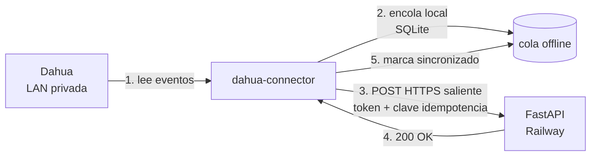

# Requisitos para la integración real con Dahua

**Nada de este documento bloquea la construcción del módulo.** El sistema se
desarrolla y se prueba completo con `MockAccessControlProvider` y el importador
CSV. Esta lista es lo que hace falta para conectar el equipo **real**.

Estado: **CONECTADO Y EN PRODUCCIÓN (2026-08-18).** El proveedor real es
`dahua-connector/proveedores/dahua_http.py`. Se leyeron los 4.788 registros del
equipo y se cargaron al OS. Lo que queda pendiente no es técnico: es una
decisión operativa sobre cómo se registran las salidas (§ "El límite de fondo").

---

## ✅ CONFIRMADO sobre el equipo real

Sondeado desde un Mac en la misma red (10.30.1.117 → 10.30.1.4, 0,5 ms).

| Dato | Valor |
|---|---|
| Modelo | **DHI-ASI6213S** (Access Standalone facial) |
| Serie | `BF0FBC9PAJA4EBF` |
| Firmware | `V3.004.0000001.0.R.20250919` |
| Web | `V5.12.0.250909.2941682` · Safe Baseline V2.4 |
| IP / MAC | `10.30.1.4` · `e0:2e:fe:d5:b7:a8` |
| **Autenticación** | **HTTP Digest MD5**, `qop=auth` |
| **Acceso al API** | **HTTPS puerto 443** — el 80 está CERRADO |
| **Puerto 37777** | **CERRADO** → el NetSDK **no** es un camino viable |
| Otros puertos | 8080 abierto · 554 (RTSP) abierto |

### Consecuencia: el camino es la API CGI sobre HTTPS

Con el 37777 cerrado, el SDK nativo queda descartado. Eso **simplifica**: es
HTTP con Digest sobre TLS, que `urllib` maneja de fábrica. El conector no
necesita binarios propietarios ni dependencias.

### ⚠️ Lección del sondeo: el 401 no prueba nada

Un primer barrido dio 401 en todos los endpoints y parecía confirmar que todos
existían. **Un control con rutas inventadas (`esto_no_existe.cgi`) también dio
401**: el equipo exige autenticación *antes* de mirar la ruta.

Así que la lista de endpoints válidos **sigue sin confirmarse**. Para eso está
`dahua-connector/descubrir.py`, que se corre con credenciales y reporta qué
responde de verdad.

**Resuelto el 2026-08-18.** Con Digest autenticado, el equipo sí discrimina:
las rutas inventadas dan `501 Not Implemented` y los nombres de conjunto
inexistentes dan `400 Bad Request`. La prueba de control se conserva dentro de
`descubrir.py` y se corre SIEMPRE antes de creerle a un barrido.

---

## 🔬 Lo que el equipo hace distinto de lo documentado

Todo esto se midió sobre sus 4.788 registros. Cada punto es una forma de
corromper la asistencia **sin que aparezca ningún error**.

### 1. El filtro de fechas se ignora en silencio

`condition.StartTime` / `condition.EndTime` devuelven `count=4785` para
cualquier rango — incluido el año 2050, donde debería dar 0.

Un conector que le crea al filtro pide "el último día", recibe el **comienzo
del búfer**, y reporta éxito. Se pagina con `offset` y se corta por `RecNo`.

### 2. `CreateTime` es epoch UTC, no hora local

Verificado por dos vías independientes:

- leyendo el epoch como hora local, **24 registros caen en el futuro** —
  imposible;
- convirtiendo UTC→Bogotá, el **100 %** de las marcaciones cae entre 06:00 y
  21:00, con pico a las **08h (1.250)** y a las **17h (791)**: exactamente una
  oficina de 8:30 a 5.

Leerlo mal corre toda la nómina 5 horas. `CreateTimeRealUTC` trae el mismo
valor; no sirve para desempatar.

### 3. El equipo NO distingue entrada de salida

| Evidencia | Valor |
|---|---|
| `Type` | `Entry` en los **4.788** registros, salidas incluidas |
| `AttendanceState` | `0` en todos |
| `Door` / `ReaderID` | uno solo (`0` / `1`) |
| `OutDoorMethodEnable` | `false` |

Por eso el conector emite `direccion_acceso='desconocida'` y el dispositivo
quedó configurado con `modo_direccion='alternado'`. Decir `'entrada'` sería
inventar un hecho que el equipo no reporta, y dejaría toda jornada abierta.

### 4. Tres clases de registro que no se pueden mezclar

| Clase | Cómo se reconoce | Cuántos | ¿Es una marcación? |
|---|---|---|---|
| Marcación atribuible | `Status=1` **y** `UserID` | 3.790 | **Sí** |
| Apertura sin lector | `Status=1`, sin `UserID`, `ReaderID` vacío | 863 | No — hecho real, de nadie |
| Intento fallido | `Status=0` (`ErrorCode` 16/20) | 135 | No — cara no reconocida |

Las aperturas sin lector son el **botón de salida** (pico a las 14h). Contarlas
regalaría horas a nadie; contarlas como del último identificado sería inventar.

### 5. `RecNo` sirve de cursor; `offset` de paginación

`RecNo` es monótono creciente y sin huecos (1…4788 verificado). `beginNumber`
se ignora; `offset` funciona. El cursor es el **RecNo**, no la posición: el
búfer es circular y al purgar, `offset N` deja de ser `RecNo N+1`.

### 6. El equipo duplica marcaciones

581 de 2.422 intervalos consecutivos son de **≤10 s**. La distribución es
bimodal (pico ≤10 s, valle, actividad real >15 min), así que la ventana de
deduplicación se fijó en **60 s** — regla `tolerancia_duplicado_seg`, con el
motivo medido guardado en `personal_reglas`.

### 7. El equipo reusa los identificadores de usuario

    UserID 007 · Hilary Zapata                13 marcaciones · abr 6 → abr 10
    UserID 007 · Alejandra Valencia Alvarez  117 marcaciones · abr 11 → jun 4

Dos personas, un id. Ver `SUPABASE_MIGRATION_PERSONAL_MAPEO_VIGENCIA.sql`.

### 8. El API expone el PIN de puerta en claro

`recordFinder.cgi?action=find&name=AccessControlCard` devuelve el campo
`Password` de cada usuario sin enmascarar. Quien tenga la clave de admin ve los
PIN de todos. El OS **no** guarda ese campo. Es una razón más para cerrar la
exposición a internet del equipo.

---

## ⚠️ El límite de fondo: el equipo captura la entrada, no la salida

Este es el hallazgo que decide qué se puede prometer, y **no es un problema de
software**.

| | |
|---|---|
| Persona-día con marcaciones | 1.365 |
| Cierran solos (nº par de marcas) | **740 · 54 %** |
| Les falta una marca (nº impar) | **625 · 46 %** |
| De los que tienen UNA sola marca, es de la mañana | **89 %** |
| Mediana de jornada cerrada | **8,39 h** (el horario es 8:30–17:00 = 8,5 h) |

La mediana confirma que el cálculo es correcto donde hay datos. El problema es
la cobertura: la puerta se **abre** con la cara (queda registro) pero se **sale**
con el botón (no queda registro de quién).

**El motor hace lo correcto:** un segmento sin cierre aporta 0 minutos y queda
`abierto` con incidencia. Nunca inventa una hora de salida. Pero eso significa
que hoy **el 46 % de los días necesita que una persona los cierre a mano**.

Opciones, en orden de menor a mayor esfuerzo:

1. **Modo asistencia en el terminal** — que el equipo pida marcar entrada/salida
   explícitamente. Es configuración del Dahua, no código.
2. **Segundo lector de salida** — habilita `OutDoorMethodEnable` y el equipo
   reporta la dirección de verdad. Es hardware.
3. **Cierre asistido** — dejarlo como está y que la administradora cierre los
   días incompletos desde el OS, con soporte y auditoría. Es lo que ya funciona.

Mientras no se decida, lo honesto es reportar el banco de horas **con la
cobertura explícita al lado**, no un número solo.

---

## 1. Por qué no se asume un protocolo

Dahua tiene al menos cuatro caminos de integración, y cuál aplica depende del
modelo, del firmware y de la licencia:

| Camino | Cuándo aplica | Riesgo |
|---|---|---|
| HTTP API del equipo (CGI) | Terminales con servidor web | Varía por firmware; no siempre documentado |
| SDK nativo (NetSDK) | Casi todos | Binario propietario, complica el despliegue |
| DSS Express / Professional | Si hay servidor DSS | Requiere licencia |
| SmartPSS Lite | Administración de escritorio | Suele ser solo exportación manual |

Inventar endpoints de un CGI no documentado produciría código que falla en
producción con un firmware distinto. Por eso el `DahuaProviderPlaceholder` tiene
la estructura, los contratos y el manejo de errores completos — pero **no**
endpoints inventados.

---

## 2. Lo que necesitamos (checklist)

### 2.1 Identificación del equipo — *bloquea la elección de protocolo*

- [ ] **Foto de la etiqueta** (parte trasera o inferior del equipo)
- [ ] **Modelo exacto** — ej. `ASI7213X-T1`, `ASI3213G-MW`
- [ ] **Número de serie**
- [ ] **Versión de firmware** — visible en la web del equipo o en *Sistema → Versión*
- [ ] **IP local** y si es fija o por DHCP

### 2.2 Administración actual — *bloquea el diseño del conector*

- [ ] ¿Cómo se administra hoy? SmartPSS Lite · DSS Express · DSS Professional ·
      web del equipo · solo en el teclado del dispositivo
- [ ] Si es DSS: versión y **si la licencia incluye API**
- [ ] Si es SmartPSS Lite: versión
- [ ] **Capturas del panel de administración** — sobre todo la pantalla de
      registros/eventos y la de configuración de usuarios

### 2.3 Topología física — *bloquea la interpretación de entrada/salida*

- [ ] ¿**Un terminal o dos**?
- [ ] Si son dos: ¿uno para entrada y otro para salida?
- [ ] ¿El equipo **distingue** entrada de salida en el registro, o solo dice
      "reconocido"?

> **Por qué importa tanto.** Si el equipo no distingue dirección, hay que
> inferirla alternando marcaciones (1ª=entrada, 2ª=salida...). Eso es frágil: una
> marcación perdida invierte todo el día. El campo
> `personal_dispositivos.modo_direccion` ya contempla los tres casos
> (`dispositivo` / `por_puerta` / `alternado`), pero **alternado genera muchas más
> incidencias**. Saberlo de antemano cambia expectativas de precisión.

### 2.4 Datos de usuario — *bloquea el mapeo de empleados*

- [ ] **Qué código identifica a cada empleado** en el Dahua (número de usuario,
      cédula, código interno)
- [ ] **Qué campos de usuario** están configurados (nombre, departamento, tarjeta)
- [ ] Listado actual de usuarios registrados, si se puede exportar

Ese código alimenta `personal_mapeo_externo.id_externo_empleado`. Sin él, todos
los eventos llegan como `empleado_desconocido`.

### 2.5 Muestra de eventos — *lo más valioso de todo*

- [ ] **Exportación de eventos de una semana** en cualquier formato (CSV, XLS,
      captura de pantalla del listado)

Con esto solo:
- validamos el parser sin tocar el equipo,
- confirmamos el formato de fecha/hora y la zona horaria,
- vemos si hay `id de evento` (define el nivel de idempotencia),
- verificamos si viene la dirección de acceso,
- alimentamos `CsvAccessControlProvider` con datos **reales**.

**Es lo que más desbloquea.** Si solo se puede conseguir una cosa de esta lista,
que sea esta.

### 2.6 Red — *bloquea el despliegue del conector*

- [ ] ¿En qué equipo correría el conector? *(¿el mismo Mac de oficina que ya
      corre el agente de impresión?)*
- [ ] ¿Ese equipo **ve** el Dahua en la red local? Verificable con `ping <IP>`
- [ ] ¿Está encendido de forma permanente?

---

## 3. Arquitectura del conector (ya decidida)

El `dahua-connector` **clona el patrón del agente de impresión** que ya está en
producción (`~/male-denim-agente-impresion`): Python sin dependencias externas,
`config.json`, poll saliente por HTTPS, reintento sin duplicar, arranque
automático por LaunchAgent (Mac) o `.bat` (Windows).

No se inventa arquitectura ni modelo de operación: se reusa uno que ya funciona
y que Sebastián ya opera.



**El Dahua nunca se expone a internet.** Solo hay tráfico saliente del conector
hacia el API. No hay puertos abiertos ni port forwarding.

### Garantías

| Propiedad | Cómo |
|---|---|
| Sin duplicados | Clave de idempotencia + índice único en `personal_eventos_crudos` |
| Sin pérdida | Cola SQLite local; se marca enviado solo con 200 OK |
| Tolerante a caídas de internet | Encola y reintenta con backoff |
| Sin secretos en claro | Token en `config.json` con permisos 600; hasheado en el servidor |
| Observable | `ultimo_contacto_at`, `ultimo_evento_at`, `version_conector` |

---

## 4. Interfaz de adaptadores

```python
class AccessControlProvider(Protocol):
    def test_connection(self) -> ConnectionResult: ...
    def list_employees(self) -> list[ExternalEmployee]: ...
    def get_events(self, cursor: str | None = None) -> EventBatch: ...
    def get_device_info(self) -> DeviceInfo: ...
    def get_health(self) -> DeviceHealth: ...
    # Opcional — solo si el protocolo soporta suscripción
    def subscribe_to_events(self, handler) -> Subscription: ...
```

Se implementa desde la Fase 6:

| Implementación | Estado | Para |
|---|---|---|
| `MockAccessControlProvider` | Fase 6 | Desarrollo y los 36 casos de prueba |
| `CsvAccessControlProvider` | Fase 6 | Carga histórica y respaldo si el conector cae |
| `DahuaProviderPlaceholder` | Fase 6 | Estructura y contratos; **sin endpoints inventados** |
| `DahuaHttpProvider` | **Bloqueado** | Requiere §2.1 y §2.2 |

Los tres primeros no dependen de ningún dato de esta lista.

---

## 5. Riesgos conocidos de la integración

| Riesgo | Mitigación |
|---|---|
| El firmware no expone API usable | Camino alterno: exportación programada + `CsvAccessControlProvider` |
| El equipo no distingue entrada/salida | `modo_direccion='alternado'` + más incidencias. Alternativa real: comprar un segundo terminal para salida |
| Reloj del Dahua desfasado | Detectar desviación comparando `event_timestamp` vs `received_at`; alertar. Idealmente sincronizar por NTP |
| DSS sin licencia de API | Ir directo al equipo o vía CSV |
| El equipo se llena y borra eventos viejos | El conector sincroniza cada pocos minutos; la cola local protege ante caídas |

---

## 6. Cómo entregar esta información

Cualquier medio sirve: fotos por WhatsApp, capturas, un archivo exportado.
No hace falta nada formal.

**Orden de utilidad:**
1. Exportación de eventos de muestra (§2.5) — desbloquea el parser
2. Foto de la etiqueta + firmware (§2.1) — decide el protocolo
3. Uno o dos terminales, y si distingue dirección (§2.3) — decide la precisión
4. El resto

---

## 7. Mientras tanto

El módulo avanza completo sin esto:

- Fases 2 a 5 no tocan el Dahua.
- Fase 6 construye mock + CSV + conector base.
- Los 36 casos de prueba corren contra el simulador.
- El punto exacto de integración queda documentado y aislado tras la interfaz.

Cuando lleguen los datos, el trabajo restante es **una sola clase**:
`DahuaHttpProvider`. Nada más del módulo cambia.
